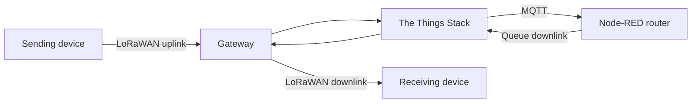

# lorawan-message

LoRaWAN messaging between end devices through a gateway and a Node-RED router. The prototype is intended for short updates in areas with limited connectivity, such as wildlife conservation teams reporting from a patrol. Coverage depends on the gateway, antenna placement, terrain, and radio link. The gateway needs a connection to the LoRaWAN network server.

The sender selects a destination with the P1.0 button and sends a test message or text from a phone over Bluetooth Low Energy (BLE). Node-RED reads the destination tag and queues the message with The Things Stack. The receiving Class A device opens its receive windows when its operator chooses **Check messages** or sends `/poll` from a connected phone. The dashboard shows queue and transmission status. The receiving device displays the text on its OLED and forwards it to a connected phone with UART open.

## Project layout

| Path | Contents |
| --- | --- |
| `networking/src/` | Pro Micro firmware, OLED button menu, radio setup, and saved LoRaWAN session |
| `networking/node-red/ttn-routing.json` | Bidirectional router and FlowFuse Dashboard |
| `networking/ttn/decode_uplink.js` | Optional TTN uplink formatter |
| `hardware/` | KiCad schematic and PCB reference for the prototype |

## Set up two devices

1. Register `custom-1` and `custom-2` as LoRaWAN 1.0.x Class A ABP devices in the same TTN application. The included firmware targets the EU868 frequency plan. Match each device's initial RX1 delay and RX2 data rate to its settings in `networking/platformio.ini`. See the [TTN ABP setup guide](https://www.thethingsindustries.com/docs/hardware/devices/adding-devices/manual/abp/).
2. Create an `end devices` folder beside `networking`. Make a copy of `networking/device.example.json` named `custom-1.json` and another named `custom-2.json` in that folder. Set each device ID and enter its own TTN values as hex strings without spaces. Git ignores the credentials folder.
3. Open `networking` in PlatformIO. Upload `gateway_connect` to the first board and `gateway_connect_custom_2` to the second board. Use `promicro_nrf52840` for an OLED bench test or `hello_ble` to test the BLE UART echo.

## Set up Node-RED

1. Install [FlowFuse Dashboard](https://dashboard.flowfuse.com/getting-started.html) in Node-RED.
2. Replace every occurrence of `your-ttn-app` in the exported flow with your TTN application ID before importing it. The export is configured for TTN EU1. If your application uses another cluster, also update the MQTT host, TLS server name, and queue API host to match.
3. Edit the MQTT broker's **Security** settings. Use `<application-id>@ttn` as the username and your TTN application API key as the password. Set the same key as the bearer token on **Queue downlink in TTN**. The key needs access to read application traffic and write downlinks. [TTN MQTT setup](https://www.thethingsindustries.com/docs/integrations/other-integrations/mqtt/)
4. Deploy the flow and open [the communications dashboard](http://localhost:1880/dashboard/communications). Optionally copy the uplink formatter into the TTN application.

## Send and receive

- Tap **P1.0** to scroll. Hold it for about 0.7 seconds to select.
- Choose **Change target** and select a device, then choose **Send hello**. The selected target is saved on the board.
- Wait for the dashboard to show the message queued, then choose **Check messages** on the receiving device. Use **Back** to return to the action menu.
- To add a device, register its ID in the TTN application, add it to `custom_end_devices` in `platformio.ini`, and rebuild the relevant boards. Give the new board its own PlatformIO profile and credential file.

### Send from a phone

1. Set the destination using **Change target**, then hold P1.0 on **BLE Control**. The board advertises for 60 seconds under a name such as `custom-1 BLE`.
2. Connect from Bluefruit LE Connect and open **UART**. Enter the pairing code shown on the OLED when prompted. Use **Back** to return to the action menu while keeping the phone connected. [Adafruit UART Terminal guide](https://learn.adafruit.com/bluefruit-le-connect/uart-terminal)
3. Type a line of up to 48 bytes and tap **Send**. Once the dashboard shows **Queued**, choose **Check messages** on the receiver or send `/poll` from its phone. Choose **Turn BLE off** in **BLE Control** to disconnect the phone.

## Message format

| Direction | FPort | Payload |
| --- | --- | --- |
| Routed uplink | 2 | One destination byte followed by message bytes |
| Poll uplink | 1 | Short poll message that opens receive windows |
| Application downlink | 1 | Message bytes forwarded to the selected device |

The tag is the decimal suffix of the device ID stored in a byte. For example, `0x02` maps to `custom-2`. The supported IDs are `custom-1` through `custom-255`. Application downlinks use the receiving device's downlink budget. Check your [network and regional airtime limits](https://www.thethingsnetwork.org/docs/lorawan/duty-cycle/) when planning field tests.

## Hardware attribution

The KiCad files in `hardware/` contain my modifications to gargomoma’s FakeTec PCB for this prototype. [Original FakeTec hardware repository](https://github.com/gargomoma/fakeTec_pcb)

I develop the modified schematic and PCB in a separate repository. [Active Meshtastic Node hardware project](https://github.com/Paulshapwala/meshtastic-node)

## Prototype wiring

The current board uses a Pro Micro nRF52840, an RA-01SH LoRa module, and an SSD1306 I²C OLED at `0x3C`.

| Signal | Pro Micro GPIO |
| --- | --- |
| OLED SDA / SCL | P1.04 / P0.11 |
| RA-01SH NSS / SCK | P1.13 / P1.11 |
| RA-01SH MOSI / MISO | P1.15 / P0.02 |
| RA-01SH DIO1 / RESET / BUSY | P0.10 / P0.09 / P0.29 |
| RA-01SH RXEN | P0.17 |
| User button | P1.00 with an active-low switch to ground |
| Switched 3.3 V enable | P0.13 |

The prototype connects the radio's DIO2 to its TXEN line. The PCB source includes its placed footprints. Editing the design with replacement parts may require the original custom footprint libraries.

## Contributing

Issues and pull requests are welcome. When sharing a bug report or change, include the board profile and what you tested. Use the Meshtastic Node hardware repository for work on the PCB. [Project issues](https://github.com/Paulshapwala/lorawan-message/issues)
